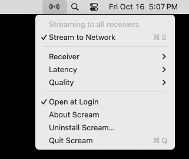
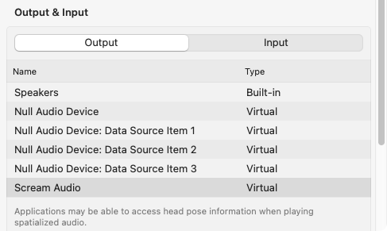
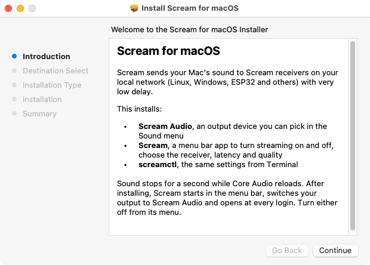

Scream for macOS
================

Send your Mac's sound to speakers anywhere on your local network, with very
low delay.

Scream for macOS adds a **Scream Audio** output device to your Mac. Pick it
like any other output and everything you play is streamed to Scream receivers
on your LAN: a Linux box with PulseAudio/PipeWire/ALSA/JACK, a Windows PC, an
ESP32 speaker, and so on. It speaks the same protocol as the original
[Scream](https://github.com/duncanthrax/scream) Windows driver, so every
existing Scream receiver works unchanged.


 Sound" width="485"/>

- Native on Apple Silicon and Intel, macOS 13 or newer.
- No kernel extension and no security settings to change: Scream Audio is a
  user-space Core Audio driver.
- Volume keys and mute work. Settings survive reboots.
- Starts with your Mac and stays out of the way in the menu bar.

Install
-------

1. Download **Scream-x.y.z.pkg** from the
   [latest release](https://github.com/ElixBerd/scream-macos/releases/latest).
2. Double-click it. The package is not notarized by Apple yet, so the first
   time macOS says it "cannot verify" it. Open **System Settings > Privacy &
   Security**, scroll down, click **Open Anyway** next to the Scream message,
   and open the package again.
3. Follow the installer. Sound pauses for a second while Core Audio reloads.



When the installer finishes, the Scream icon (radio waves) appears in the
menu bar, your output switches to **Scream Audio**, and Scream is set to open
at login. Start a receiver on your network and play something.

Using it
--------

Click the radio-waves icon in the menu bar:

| Menu item | What it does |
|---|---|
| **Stream to Network** (⌘S) | Switches the Mac's output to Scream Audio, or back to the speakers or headphones you used before. The icon is dimmed while not streaming. |
| **Receiver** | *All Receivers* (multicast, the default) or one receiver by IP address. Recent addresses are remembered. |
| **Latency** | Packet size. *Lowest* (1.5 ms at 48 kHz) has the least delay; *Standard* (6 ms) works with every receiver. |
| **Quality** | 16, 24 or 32 bit; 44.1, 48, 88.2 or 96 kHz. 48 kHz / 16 bit is plenty for most setups. The Format menu for Scream Audio in Audio MIDI Setup changes the same setting. |
| **Open at Login** | Start Scream with your Mac (on by default). |
| **Uninstall Scream…** | Removes everything, see below. |

You can also pick **Scream Audio** directly in System Settings > Sound, in
Control Center, or in any app's output menu, just like AirPlay or USB
speakers. The same settings are available in Terminal through `screamctl`
(`screamctl -h`).

Setting up a receiver
---------------------

On Linux, build the receiver from [Receivers/unix](Receivers/unix) and run it:

```sh
scream -o pulse              # PulseAudio / PipeWire, multicast
scream -o alsa               # plain ALSA
scream -u -o pulse           # unicast: then choose this machine's IP in Receiver
```

If the receiver has a firewall, open **UDP port 4010**. Other receivers:
Windows [ScreamReader](Receivers/dotnet-windows), Android
([Receivers/android](Receivers/android)), and third-party ones such as
[ESP32](http://tomeko.net/projects/esp32_rtp_pager/) and
[STM32](http://tomeko.net/projects/scream_eth/) speakers,
[cornrow](https://github.com/mincequi/cornrow) and
[freeRtr](https://github.com/mc36/freeRtr/tree/master/misc/streamer).

Getting the lowest delay
------------------------

The Mac sends every audio buffer the moment Core Audio hands it over, so most
of the delay you hear is the receiver's buffer.

- Lower the receiver's buffer: `scream -o pulse -t 10` (the default is 50 ms).
  If you hear dropouts, go up to 20.
- Choose **Latency > Lowest** in the menu. The Linux receiver supports it;
  if another receiver goes silent, use *Standard*.
- Use wired Ethernet if you can. On Wi-Fi, prefer a specific receiver over
  *All Receivers*: many access points send multicast slowly and drop it.

Uninstall
---------

Choose **Uninstall Scream…** in the menu and enter your password. If you
already dragged Scream to the Trash, run this in Terminal instead:

```sh
sudo scream-uninstall
```

Both remove the app, the Scream Audio device and the command line tools, and
your Mac switches back to its own speakers.

Building from source
--------------------

```sh
cd Senders/macos
make            # driver, menu bar app, screamctl
make pkg        # build/Scream-<version>.pkg
sudo make install
```

You need the Xcode Command Line Tools (`xcode-select --install`). See
[Senders/macos/README.md](Senders/macos/README.md) for how the driver works,
and the [GitHub Actions workflow](.github/workflows/macos-sender.yml) that
builds, installs and stream-tests every change on a real Mac. Pushing a `v*`
tag publishes the installer as a release.

Protocol
--------

Audio goes out as UDP to multicast `239.255.77.77:4010` (or to one unicast
address). Each packet has a 5 byte header followed by up to 1152 bytes of
little-endian PCM:

| Byte | Meaning |
|---|---|
| 0 | Sample rate. Bit 7 selects the base, 0 = 48 kHz, 1 = 44.1 kHz; the other bits are the multiplier. |
| 1 | Sample width in bits (16, 24, 32). |
| 2 | Number of channels. |
| 3-4 | Channel mask (`dwChannelMask` of `WAVEFORMATEXTENSIBLE`), little-endian. |

A Wireshark dissector lives in [tools/wireshark](tools/wireshark).

About this fork
---------------

This is a fork of [duncanthrax/scream](https://github.com/duncanthrax/scream)
by Tom Kistner and contributors, which provides the Windows driver and the
receivers. Everything macOS-specific is in [Senders/macos](Senders/macos).
The Windows driver source is still here, unchanged; its documentation is in
[doc/WINDOWS.md](doc/WINDOWS.md).

Licensed under MS-PL, like the original. See [LICENSE](LICENSE).
